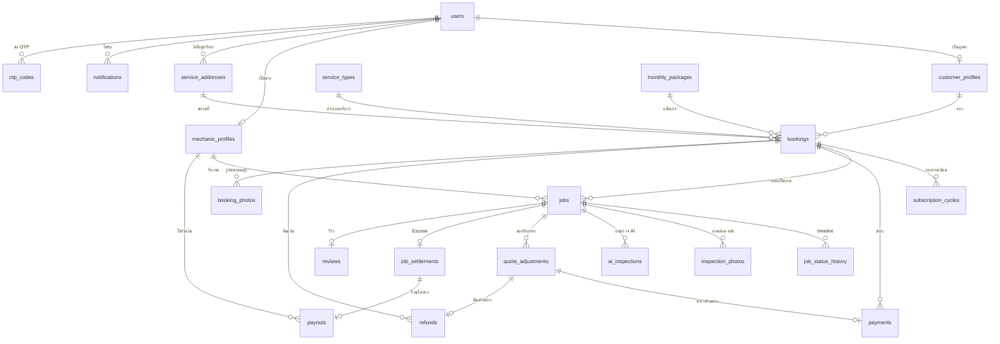

# การออกแบบฐานข้อมูล — LawnFlow (แพลตฟอร์มจ้างช่างตัดหญ้า)

เอกสารนี้ออกแบบฐานข้อมูลสำหรับแทนที่ข้อมูลตัวอย่างที่ตอนนี้เก็บไว้ในหน้าเว็บ (state ของ React และ `localStorage`)
อ้างอิงจาก `PRD.md` (โดยเฉพาะข้อ 4–7) และฟีเจอร์ที่สร้างแล้วในโค้ด

- **ฐานข้อมูลเป้าหมาย:** PostgreSQL 15+ (ใช้ `enum`, `jsonb`, partial unique index, `timestamptz`)
- **หน่วยเงิน:** `numeric(12,2)` หน่วยบาท (THB) — ราคาในระบบปัจจุบันเป็นจำนวนเต็ม แต่เผื่อทศนิยมสำหรับค่าธรรมเนียม
- **เวลา:** `timestamptz` เก็บเป็น UTC, แสดงผลเป็นเวลาไทย (Asia/Bangkok) และปี พ.ศ. ที่ฝั่งหน้าเว็บ
- **วันนัดหมาย:** `date` + `time` แยกกัน เพราะกฎ "วันละ 1 งาน" และ "ยกเลิกก่อน 2 วัน" คิดเป็นวัน
- **ชื่อตาราง/คอลัมน์:** ภาษาอังกฤษ snake_case, คำอธิบายภาษาไทย

---

## 1. ภาพรวมความสัมพันธ์ (ER Diagram)



### แนวคิดหลักของโครงสร้าง

| แนวคิด | เหตุผล |
|---|---|
| **แยก `bookings` (การจอง/การชำระ) ออกจาก `jobs` (การไปทำงานแต่ละครั้ง)** | แพ็กเกจรายเดือน 1 การจองมีหลายครั้งต่อเดือนและหลายเดือน แต่ละครั้งเป็นงานแยกที่ช่างรับได้คนละคน มีสถานะ ราคา Escrow และรีวิวของตัวเอง |
| **คัดลอกที่อยู่และราคาลงในงาน (snapshot)** | ถ้าลูกค้าแก้ไขที่อยู่หรือแอดมินเปลี่ยนตารางราคาภายหลัง งานเก่าต้องยังแสดงข้อมูลตามที่ตกลงไว้ |
| **ตารางราคาเป็นข้อมูล ไม่ฝังในโค้ด** | ราคา 6 บริการ ตัวคูณความสูงหญ้า ส่วนลดแพ็กเกจ และค่า Platform 15% แอดมินปรับได้โดยไม่ต้องแก้โค้ด |
| **เงินทุกก้อนมีรายการของตัวเอง** | ชำระ (`payments`), คืนเงิน (`refunds`), พักเงิน (`job_settlements`), โอนให้ช่าง (`payouts`) — ตรวจสอบย้อนหลังได้ และรายงานรายรับคำนวณจากตารางเหล่านี้ |

---

## 2. Enum

```sql
CREATE TYPE user_role            AS ENUM ('customer', 'mechanic', 'admin');
CREATE TYPE user_status          AS ENUM ('active', 'suspended');
CREATE TYPE otp_purpose          AS ENUM ('register', 'login', 'change_phone');
CREATE TYPE verification_status  AS ENUM ('pending_verification', 'verified', 'rejected');
CREATE TYPE pricing_mode         AS ENUM ('single', 'monthly');
CREATE TYPE booking_status       AS ENUM ('pending_payment', 'paid', 'cancelled', 'completed');
CREATE TYPE cycle_status         AS ENUM ('upcoming', 'active', 'completed', 'refunded');

-- สถานะงาน: ตรงกับปุ่มของช่าง (ถึงที่นัดหมาย → เริ่มทำงาน → ทำงานเสร็จ) และ step tracker ของลูกค้า
CREATE TYPE job_status AS ENUM (
  'open',        -- รอช่างรับ (อยู่ใน Job Pool)
  'matched',     -- จับคู่ช่างแล้ว
  'arrived',     -- ช่างถึงที่นัดหมายแล้ว
  'working',     -- กำลังทำงาน
  'completed',   -- ทำงานเสร็จ รอตรวจรับ/รีวิว
  'closed',      -- เสร็จสมบูรณ์ (รีวิวแล้ว หรือครบเวลา)
  'cancelled'
);
CREATE TYPE cancelled_by         AS ENUM ('customer', 'mechanic', 'admin', 'system');
CREATE TYPE photo_kind           AS ENUM ('before', 'after');
CREATE TYPE adjustment_decision  AS ENUM ('pending', 'accepted', 'rejected', 'expired');
CREATE TYPE adjustment_settlement AS ENUM ('awaiting_payment', 'paid_difference', 'refunded', 'no_change');
CREATE TYPE payment_type         AS ENUM ('booking', 'adjustment_difference');
CREATE TYPE payment_status       AS ENUM ('pending', 'paid', 'failed', 'expired');
CREATE TYPE refund_reason        AS ENUM ('customer_cancel', 'price_decrease', 'subscription_cancel', 'admin');
CREATE TYPE refund_status        AS ENUM ('requested', 'processing', 'completed', 'failed');
CREATE TYPE settlement_status    AS ENUM ('held', 'released', 'refunded');
CREATE TYPE payout_status        AS ENUM ('requested', 'processing', 'completed', 'failed');
CREATE TYPE notification_type AS ENUM (
  'job_matched', 'mechanic_arrived', 'work_started', 'work_completed_review_request',
  'adjustment_requested', 'adjustment_accepted', 'adjustment_rejected', 'adjustment_expired', 'adjustment_difference_paid',
  'job_cancelled_by_customer', 'job_cancelled_by_mechanic', 'refund_completed',
  'payout_completed', 'verification_approved', 'verification_rejected',
  'rain_rescheduled', 'rematched'
);
```

---

## 3. ผู้ใช้และการยืนยันตัวตน

### 3.1 `users` — บัญชีผู้ใช้ทุกบทบาท (PRD 6.1)

| คอลัมน์ | ชนิด | ข้อกำหนด | หมายเหตุ |
|---|---|---|---|
| id | `uuid` | PK | |
| role | `user_role` | NOT NULL | ลูกค้า / ช่าง / แอดมิน |
| first_name | `varchar(100)` | NOT NULL | แยกชื่อ-นามสกุล เพราะชื่อบัญชีรับเงินคืนต้องตรงกับที่ลงทะเบียน |
| last_name | `varchar(100)` | NOT NULL | |
| phone | `varchar(10)` | NOT NULL, UNIQUE, CHECK `^0[0-9]{9}$` | เก็บเฉพาะตัวเลข 10 หลัก |
| phone_verified | `boolean` | NOT NULL DEFAULT false | ตั้งเป็น true เมื่อยืนยัน OTP สำเร็จ |
| email | `varchar(255)` | UNIQUE (ไม่บังคับสำหรับช่าง) | ลูกค้าต้องมี (ตรวจในแอป) |
| password_hash | `text` | | bcrypt/argon2 — ห้ามเก็บรหัสผ่านจริง (PRD 8.1) |
| status | `user_status` | NOT NULL DEFAULT 'active' | ลูกค้า active ทันทีหลังยืนยัน OTP |
| created_at / updated_at | `timestamptz` | NOT NULL DEFAULT now() | |

### 3.2 `otp_codes` — รหัส OTP 6 หลัก

| คอลัมน์ | ชนิด | ข้อกำหนด | หมายเหตุ |
|---|---|---|---|
| id | `bigserial` | PK | |
| phone | `varchar(10)` | NOT NULL | ยังไม่มี user_id ตอนลงทะเบียน |
| purpose | `otp_purpose` | NOT NULL | |
| code_hash | `text` | NOT NULL | เก็บ hash ของรหัส ไม่เก็บรหัสจริง |
| attempts | `smallint` | NOT NULL DEFAULT 0 | จำกัดจำนวนครั้งที่กรอกผิด |
| sent_at | `timestamptz` | NOT NULL DEFAULT now() | ใช้ตรวจ cooldown 60 วินาที |
| expires_at | `timestamptz` | NOT NULL | sent_at + 5 นาที |
| consumed_at | `timestamptz` | | ใช้แล้ว |

```sql
CREATE INDEX otp_codes_phone_sent_idx ON otp_codes (phone, sent_at DESC);
```
กฎ: ขอรหัสใหม่ได้เมื่อ `now() >= max(sent_at) + 60 วินาที` (PRD 4.1.1) · รหัสผิดหรือ `expires_at` ผ่านแล้ว ต้องแจ้งเตือน

### 3.3 `customer_profiles` (PRD 6.2)

| คอลัมน์ | ชนิด | ข้อกำหนด |
|---|---|---|
| user_id | `uuid` | PK, FK → users.id |
| default_service_address_id | `uuid` | FK → service_addresses.id |
| preferred_contact_method | `varchar(20)` | DEFAULT 'phone' |
| accepted_terms_at | `timestamptz` | NOT NULL |

### 3.4 `mechanic_profiles` — ข้อมูลช่าง (PRD 6.3, 4.2.1)

| คอลัมน์ | ชนิด | ข้อกำหนด | หมายเหตุ |
|---|---|---|---|
| user_id | `uuid` | PK, FK → users.id | |
| photo_url | `text` | NOT NULL | รูปโปรไฟล์ แสดงให้ลูกค้าเห็นเมื่อรับงาน |
| id_card_image_url | `text` | NOT NULL | ที่เก็บไฟล์แบบจำกัดสิทธิ์ (เฉพาะแอดมิน) |
| bank_name | `varchar(100)` | NOT NULL | |
| bank_account_number_enc | `bytea` | NOT NULL | **เข้ารหัส** (PRD 8.1) |
| bank_account_last4 | `char(4)` | NOT NULL | ใช้แสดง "xxx-7890" โดยไม่ต้องถอดรหัส |
| bank_account_name | `varchar(200)` | NOT NULL | |
| service_radius_km | `smallint` | NOT NULL CHECK IN (5,10,20,30,50) | |
| base_address_line | `text` | NOT NULL | ที่อยู่ปัจจุบัน = จุดฐานคำนวณระยะทาง |
| base_province / base_amphoe / base_district | `varchar(100)` | province, amphoe NOT NULL | |
| base_zipcode | `char(5)` | | |
| base_lat / base_lng | `numeric(9,6)` | **NOT NULL** | บังคับปักหมุด เพราะใช้คำนวณระยะทาง |
| verification_status | `verification_status` | NOT NULL DEFAULT 'pending_verification' | |
| reject_reason | `text` | | บังคับเมื่อ rejected (CHECK) |
| reviewed_by | `uuid` | FK → users.id (admin) | |
| reviewed_at | `timestamptz` | | |
| vip_status | `boolean` | NOT NULL DEFAULT false | เห็นงานก่อน 30 วินาที (PRD 5.2) |
| rating_average | `numeric(2,1)` | NOT NULL DEFAULT 0 | ค่าแคช อัปเดตเมื่อมีรีวิวใหม่ |
| rating_count | `integer` | NOT NULL DEFAULT 0 | |
| completed_jobs_count | `integer` | NOT NULL DEFAULT 0 | แสดงบนการ์ด "ช่างของคุณ" |
| accepted_terms_at / submitted_at | `timestamptz` | NOT NULL | |

```sql
ALTER TABLE mechanic_profiles ADD CONSTRAINT reject_needs_reason
  CHECK (verification_status <> 'rejected' OR reject_reason IS NOT NULL);
CREATE INDEX mechanic_profiles_verification_idx ON mechanic_profiles (verification_status);
```
กฎ: ช่างที่ `verification_status <> 'verified'` **รับงานไม่ได้** (PRD 4.2.1)

### 3.5 `service_addresses` — ที่อยู่บริการของลูกค้า (PRD 6.4)

| คอลัมน์ | ชนิด | ข้อกำหนด | หมายเหตุ |
|---|---|---|---|
| id | `uuid` | PK | |
| user_id | `uuid` | NOT NULL, FK → users.id | |
| label | `varchar(50)` | NOT NULL | บ้าน / ที่ทำงาน / อื่นๆ |
| address_line | `text` | NOT NULL | "ห้องเลขที่, บ้านเลขที่, ตึก, หมู่บ้าน, ถนน" ช่องเดียว |
| province | `varchar(100)` | NOT NULL | |
| amphoe | `varchar(100)` | NOT NULL | เขต/อำเภอ |
| district | `varchar(100)` | | แขวง/ตำบล (ไม่บังคับ) |
| zipcode | `char(5)` | | ได้จาก thai-address-database เมื่อเลือกตำบล |
| lat / lng | `numeric(9,6)` | | ปักหมุด (แนะนำ ไม่บังคับ) |
| is_default | `boolean` | NOT NULL DEFAULT false | |
| deleted_at | `timestamptz` | | ลบแบบ soft delete เพราะงานเก่ายังอ้างถึง |
| created_at / updated_at | `timestamptz` | | |

```sql
-- ที่อยู่หลักได้ 1 แห่งต่อผู้ใช้
CREATE UNIQUE INDEX service_addresses_one_default
  ON service_addresses (user_id) WHERE is_default AND deleted_at IS NULL;
```
กฎ: ต้องมีที่อยู่บริการอย่างน้อย 1 แห่ง (ตรวจในแอปก่อนลบ)

---

## 4. ตารางราคา (Pricing Engine — PRD 7)

### 4.1 `service_types` — ประเภทบริการ 6 แบบ

| คอลัมน์ | ชนิด | หมายเหตุ |
|---|---|---|
| code | `varchar(40)` PK | เช่น `mow_only_no_haul` |
| name | `varchar(100)` NOT NULL | "ตัดหญ้าอย่างเดียว ไม่ขนทิ้ง" |
| base_price | `numeric(12,2)` NOT NULL | ราคาเมื่อไม่เกิน base_area_wa |
| base_area_wa | `integer` NOT NULL DEFAULT 100 | |
| extra_per_wa | `numeric(12,2)` NOT NULL | บวกเพิ่มต่อตารางวาที่เกิน |
| sort_order | `smallint` NOT NULL | ไม่ขนทิ้งก่อน ขนทิ้งหลัง |
| is_active | `boolean` NOT NULL DEFAULT true | |

ข้อมูลเริ่มต้น:

| code | name | base_price | extra_per_wa |
|---|---|---|---|
| mow_only_no_haul | ตัดหญ้าอย่างเดียว ไม่ขนทิ้ง | 800 | 2 |
| mow_only_haul | ตัดหญ้าอย่างเดียว ขนทิ้ง | 1000 | 3 |
| mow_trim_no_haul | ตัดหญ้าและแต่งกิ่ง ไม่ขนทิ้ง | 1000 | 3 |
| mow_trim_haul | ตัดหญ้าและแต่งกิ่ง ขนทิ้ง | 1200 | 4 |
| trim_only_no_haul | แต่งกิ่งอย่างเดียว ไม่ขนทิ้ง | 1000 | 3 |
| trim_only_haul | แต่งกิ่งอย่างเดียว ขนทิ้ง | 1200 | 4 |

### 4.2 `grass_height_levels`

| level (PK) | label | multiplier |
|---|---|---|
| 0 | น้อยกว่า 6" | 1.0 |
| 1 | มากกว่า 6" | 1.5 |
| 2 | มากกว่า 12" | 2.0 |

### 4.3 `monthly_packages`

| คอลัมน์ | ชนิด | หมายเหตุ |
|---|---|---|
| code | `varchar(40)` PK | |
| name | `varchar(100)` NOT NULL | |
| visits_per_month | `smallint` | null = ทุกวันยกเว้นวันอาทิตย์ |
| pricing_service_code | `varchar(40)` FK → service_types | คิดราคาต่อครั้งด้วยบริการนี้ |
| discount_percent | `numeric(5,2)` NOT NULL DEFAULT 0 | |
| fixed_monthly_price | `numeric(12,2)` | ถ้ามี = ราคาคงที่ ไม่ขึ้นกับพื้นที่ |
| sort_order | `smallint` | |

| code | name | visits | pricing_service | discount | fixed |
|---|---|---|---|---|---|
| monthly_1 | 1 ครั้งต่อเดือน | 1 | mow_trim_haul | 10% | — |
| monthly_2 | 2 ครั้งต่อเดือน | 2 | mow_trim_haul | 15% | — |
| monthly_3 | 3 ครั้งต่อเดือน | 3 | mow_trim_haul | 20% | — |
| monthly_no_sunday | รายเดือน (หยุดวันอาทิตย์) | null | — | 0 | 14,100 |

### 4.4 `platform_settings` — ค่าคงที่ของระบบ (key/value)

| key | value | ใช้ที่ |
|---|---|---|
| platform_fee_percent | 15 | ราคาสุทธิของช่าง = ราคาลูกค้า × 0.85 |
| debris_rate_per_hour | 200 | ค่าเคลียร์เศษวัสดุ (PRD 4.2.5) |
| prepaid_month_options | [3, 6, 12] | ตัวเลือกชำระล่วงหน้า |
| customer_cancel_days_before | 2 | ลูกค้ายกเลิกได้ก่อนวันนัด 2 วัน |
| mechanic_cancel_days_before | 2 | ช่างยกเลิกได้ก่อนวันนัด 2 วัน |
| escrow_release_days | 2 | ช่างโอนเงินได้หลังทำงานเสร็จ 2 วัน (ถ้าลูกค้าไม่รีวิว) |
| max_jobs_per_mechanic_per_day | 1 | |
| vip_head_start_seconds | 30 | |
| max_lawn_photos | 10 | |
| otp_cooldown_seconds / otp_valid_minutes | 60 / 5 | |
| adjustment_expiry_minutes | 60 | คำขอปรับราคาหมดอายุ ถ้าลูกค้าไม่ตอบภายใน 1 ชั่วโมง |

คอลัมน์: `key varchar(60) PK`, `value jsonb NOT NULL`, `updated_by uuid`, `updated_at timestamptz`

**สูตรราคาต่อครั้ง** (ใช้ทั้งการจองและการขอปรับราคา):
```
ราคา = round((base_price + max(พื้นที่ − base_area_wa, 0) × extra_per_wa) × multiplier ความสูงหญ้า)
แพ็กเกจ 1–3 ครั้ง/เดือน = round(ราคาต่อครั้ง(pricing_service) × visits_per_month × (1 − discount))
ยอดชำระแพ็กเกจ = ราคาต่อเดือน × prepaid_months
```

---

## 5. การจองและงาน

### 5.1 `bookings` — การจองและชำระเงินของลูกค้า 1 ครั้ง

| คอลัมน์ | ชนิด | ข้อกำหนด | หมายเหตุ |
|---|---|---|---|
| id | `uuid` | PK | |
| customer_id | `uuid` | NOT NULL, FK → users.id | |
| service_address_id | `uuid` | NOT NULL, FK → service_addresses.id | ที่อยู่ที่ลูกค้าเลือกในใบเสนอราคา |
| pricing_mode | `pricing_mode` | NOT NULL | จ่ายครั้งเดียว / แพ็กเกจรายเดือน |
| service_type_code | `varchar(40)` | FK → service_types | บังคับเมื่อ single |
| monthly_package_code | `varchar(40)` | FK → monthly_packages | บังคับเมื่อ monthly |
| prepaid_months | `smallint` | CHECK IN (3,6,12) | บังคับเมื่อ monthly |
| area_sq_wah | `integer` | CHECK > 0 | |
| grass_height_level | `smallint` | FK → grass_height_levels | |
| first_appointment_date | `date` | NOT NULL | |
| unit_price | `numeric(12,2)` | NOT NULL | ราคาต่อครั้ง (single) หรือต่อเดือน (monthly) ณ เวลาจอง |
| total_amount | `numeric(12,2)` | NOT NULL | ยอดที่ต้องชำระ |
| price_breakdown | `jsonb` | NOT NULL | snapshot สูตร: base, extra, multiplier, discount |
| status | `booking_status` | NOT NULL DEFAULT 'pending_payment' | |
| cancelled_at | `timestamptz` | | |
| created_at / updated_at | `timestamptz` | | |

```sql
ALTER TABLE bookings ADD CONSTRAINT booking_mode_fields CHECK (
  (pricing_mode = 'single'  AND service_type_code IS NOT NULL AND monthly_package_code IS NULL AND prepaid_months IS NULL) OR
  (pricing_mode = 'monthly' AND monthly_package_code IS NOT NULL AND prepaid_months IS NOT NULL)
);
CREATE INDEX bookings_customer_idx ON bookings (customer_id, created_at DESC);
```

### 5.2 `booking_photos` — รูปสนามหญ้าที่ลูกค้าแนบ (สูงสุด 10 รูป)

| คอลัมน์ | ชนิด | หมายเหตุ |
|---|---|---|
| id | `uuid` PK | |
| booking_id | `uuid` NOT NULL FK → bookings.id ON DELETE CASCADE | |
| url | `text` NOT NULL | object storage |
| sort_order | `smallint` NOT NULL | |
| created_at | `timestamptz` | |

กฎ: ไม่เกิน `max_lawn_photos` ต่อการจอง (ตรวจในแอป หรือ trigger)

### 5.3 `subscription_cycles` — รอบบริการรายเดือน (PRD 6.10)

| คอลัมน์ | ชนิด | หมายเหตุ |
|---|---|---|
| id | `uuid` PK | |
| booking_id | `uuid` NOT NULL FK → bookings.id | |
| cycle_no | `smallint` NOT NULL | 1..prepaid_months |
| cycle_month | `date` NOT NULL | วันแรกของเดือน |
| mechanic_id | `uuid` FK → users.id | ช่างที่รับงานของรอบนี้ทั้งเดือน (null = ยังไม่มีช่างรับ) |
| accepted_at | `timestamptz` | |
| amount | `numeric(12,2)` NOT NULL | ราคาต่อเดือน |
| status | `cycle_status` NOT NULL DEFAULT 'upcoming' | |
| started_at / ended_at | `timestamptz` | |

```sql
CREATE UNIQUE INDEX subscription_cycles_unique ON subscription_cycles (booking_id, cycle_no);
```
กฎคืนเงิน rolling-cycle (PRD 5.4): เดือนที่ `active` ไม่คืน, คืนเฉพาะรอบ `upcoming` → เปลี่ยนเป็น `refunded`

**ช่างคนเดียวรับงานแพ็กเกจทั้งเดือน (PRD 7.2):** งานทุกครั้งของรอบเดือนถูกสร้างล่วงหน้าใน `jobs` (อ้าง `cycle_id`)
ใน Job Pool แสดงรอบเดือนเป็นรายการเดียว เมื่อช่างกดรับ ระบบมอบงาน **ทุกครั้งในรอบนั้น** ให้ช่างคนเดียวกันใน transaction เดียว:

```sql
BEGIN;
UPDATE subscription_cycles SET mechanic_id = :mechanic, accepted_at = now()
WHERE id = :cycle AND mechanic_id IS NULL;             -- 0 แถว = มีช่างรับไปแล้ว → ROLLBACK
UPDATE jobs SET mechanic_id = :mechanic, status = 'matched', accepted_at = now()
WHERE cycle_id = :cycle AND status = 'open';
COMMIT;  -- ถ้าวันใดชนกับงานอื่นของช่าง unique index jobs_one_per_mechanic_per_day จะทำให้ทั้ง transaction ล้มเหลว
```
- แพ็กเกจ "หยุดวันอาทิตย์" มีงานเกือบทุกวัน ช่างที่รับจึงรับงานอื่นในวันเหล่านั้นไม่ได้ ซึ่งเป็นไปตามกฎวันละ 1 งาน
- รอบเดือนถัดไปเปิดเข้า Job Pool ใหม่ โดยให้ช่างคนเดิมมีสิทธิ์รับก่อน (แนะนำ) หรือมอบให้คนเดิมอัตโนมัติ — ต้องกำหนดเพิ่ม

### 5.4 `jobs` — งานแต่ละครั้งที่ช่างไปทำ (PRD 6.5)

| คอลัมน์ | ชนิด | ข้อกำหนด | หมายเหตุ |
|---|---|---|---|
| id | `uuid` | PK | |
| booking_id | `uuid` | NOT NULL, FK → bookings.id | |
| cycle_id | `uuid` | FK → subscription_cycles.id | เฉพาะงานแพ็กเกจ |
| customer_id | `uuid` | NOT NULL, FK → users.id | ซ้ำกับ booking เพื่อ query เร็ว |
| mechanic_id | `uuid` | FK → users.id | null = ยังอยู่ใน Job Pool |
| title | `varchar(100)` | | |
| is_monthly | `boolean` | NOT NULL | งานแพ็กเกจ **ขอปรับราคาไม่ได้** |
| service_name | `varchar(150)` | NOT NULL | snapshot ชื่อบริการที่แสดงบนการ์ด |
| service_type_code | `varchar(40)` | FK → service_types | ใช้คำนวณราคาใหม่ตอนปรับราคา |
| area_sq_wah | `integer` | NOT NULL | เปลี่ยนได้เมื่อลูกค้ายอมรับการปรับราคา |
| grass_height_level | `smallint` | NOT NULL | เช่นเดียวกัน |
| appointment_date | `date` | NOT NULL | |
| appointment_time | `time` | | |
| address_line, province, amphoe, district, zipcode | | NOT NULL (บางส่วน) | **snapshot** ที่อยู่ ณ เวลาจอง |
| lat / lng | `numeric(9,6)` | | ใช้คำนวณระยะทางจากจุดฐานช่าง |
| quote_amount | `numeric(12,2)` | NOT NULL | ราคาตอนจอง (ราคาลูกค้า) |
| extra_charges | `numeric(12,2)` | NOT NULL DEFAULT 0 | ค่าเคลียร์เศษวัสดุที่ยอมรับแล้ว (สะสม) |
| final_amount | `numeric(12,2)` | NOT NULL | ราคาปัจจุบัน — เปลี่ยนเฉพาะเมื่อลูกค้ายอมรับการปรับราคา |
| platform_fee_percent | `numeric(5,2)` | NOT NULL | snapshot 15% ณ เวลาสร้างงาน |
| status | `job_status` | NOT NULL DEFAULT 'open' | |
| visible_to_vip_at | `timestamptz` | NOT NULL | เวลาที่งานเข้า Job Pool |
| visible_to_all_at | `timestamptz` | NOT NULL | = visible_to_vip_at + 30 วินาที |
| accepted_at / arrived_at / started_at / completed_at / closed_at | `timestamptz` | | เวลาของแต่ละขั้น |
| cancelled_at | `timestamptz` | | |
| cancelled_by | `cancelled_by` | | |
| cancel_reason | `text` | | |
| created_at / updated_at | `timestamptz` | | |

```sql
-- ช่างรับงานได้วันละ 1 งาน (ไม่นับงานที่ยกเลิก)
CREATE UNIQUE INDEX jobs_one_per_mechanic_per_day
  ON jobs (mechanic_id, appointment_date)
  WHERE mechanic_id IS NOT NULL AND status <> 'cancelled';

-- Job Pool: งานที่ยังไม่มีช่าง เรียงตามวันนัดหมาย
CREATE INDEX jobs_pool_idx ON jobs (appointment_date, appointment_time)
  WHERE status = 'open';

-- งานของฉัน (ช่าง) และงานของลูกค้า
CREATE INDEX jobs_mechanic_idx ON jobs (mechanic_id, appointment_date);
CREATE INDEX jobs_customer_idx ON jobs (customer_id, appointment_date DESC);

ALTER TABLE jobs ADD CONSTRAINT mechanic_required_after_open
  CHECK (status IN ('open', 'cancelled') OR mechanic_id IS NOT NULL);
```

**การรับงาน** ต้องทำใน transaction เดียวกันเพื่อกันช่างสองคนกดพร้อมกัน:
```sql
UPDATE jobs SET mechanic_id = :mechanic, status = 'matched', accepted_at = now()
WHERE id = :job AND status = 'open' AND mechanic_id IS NULL
  AND now() >= CASE WHEN :is_vip THEN visible_to_vip_at ELSE visible_to_all_at END;
-- 0 แถว = มีคนรับไปแล้ว / ยังไม่ถึงเวลา · unique index กันกรณีมีงานวันเดียวกันแล้ว
```

### 5.5 `job_status_history` — timeline สถานะงาน (PRD 5.5)

| คอลัมน์ | ชนิด | หมายเหตุ |
|---|---|---|
| id | `bigserial` PK | |
| job_id | `uuid` NOT NULL FK → jobs.id | |
| from_status / to_status | `job_status` | |
| changed_by | `uuid` FK → users.id | null = ระบบ |
| note | `text` | เช่น เหตุผลการยกเลิก / เลื่อนเพราะฝนตก |
| created_at | `timestamptz` NOT NULL DEFAULT now() | |

---

## 6. ตรวจงานและปรับราคา (PRD 4.2.5, 5.3)

### 6.1 `inspection_photos` — ภาพก่อน-หลังทำงาน

| คอลัมน์ | ชนิด | หมายเหตุ |
|---|---|---|
| id | `uuid` PK | |
| job_id | `uuid` NOT NULL FK → jobs.id | |
| kind | `photo_kind` NOT NULL | before / after |
| url | `text` NOT NULL | |
| uploaded_by | `uuid` NOT NULL FK → users.id | |
| created_at | `timestamptz` | |

### 6.2 `ai_inspections` — ผลวิเคราะห์ภาพ

| คอลัมน์ | ชนิด | หมายเหตุ |
|---|---|---|
| id | `uuid` PK | |
| job_id | `uuid` NOT NULL FK → jobs.id | |
| before_photo_id / after_photo_id | `uuid` FK → inspection_photos.id | |
| completeness_percent | `smallint` | ความเรียบร้อยของงาน |
| estimated_area_sq_wah | `integer` | |
| detected_grass_height_level | `smallint` | |
| estimated_debris_hours | `smallint` | |
| model_version | `varchar(50)` | |
| raw_result | `jsonb` | ผลดิบจากบริการ AI |
| created_at | `timestamptz` | |

### 6.3 `quote_adjustments` — คำขอปรับราคาหน้างาน (PRD 6.7)

| คอลัมน์ | ชนิด | ข้อกำหนด | หมายเหตุ |
|---|---|---|---|
| id | `uuid` | PK | |
| job_id | `uuid` | NOT NULL, FK → jobs.id | |
| requested_by | `uuid` | NOT NULL, FK → users.id | ช่าง |
| ai_inspection_id | `uuid` | FK → ai_inspections.id | ถ้าใช้ค่าจาก AI |
| old_amount | `numeric(12,2)` | NOT NULL | = jobs.final_amount ตอนขอ |
| new_amount | `numeric(12,2)` | NOT NULL, CHECK <> old_amount | |
| new_area_sq_wah | `integer` | NOT NULL | |
| new_grass_height_level | `smallint` | NOT NULL | |
| debris_hours | `smallint` | NOT NULL DEFAULT 0 | |
| new_extra_charges | `numeric(12,2)` | NOT NULL | ค่าใช้จ่ายเพิ่มสะสมหลังปรับ |
| reasons | `text[]` | NOT NULL | สาเหตุที่ระบบสร้าง เช่น "พื้นที่จริง 130 ตารางวา (แจ้งไว้ 120)" |
| note | `text` | | หมายเหตุจากช่าง |
| customer_decision | `adjustment_decision` | NOT NULL DEFAULT 'pending' | |
| settlement | `adjustment_settlement` | | |
| decided_at | `timestamptz` | | |
| expires_at | `timestamptz` | NOT NULL | created_at + 1 ชั่วโมง |
| created_at | `timestamptz` | | |

```sql
-- มีคำขอที่รอได้ครั้งละ 1 คำขอต่องาน
CREATE UNIQUE INDEX quote_adjustments_one_open
  ON quote_adjustments (job_id)
  WHERE customer_decision = 'pending' OR settlement = 'awaiting_payment';
```
กฎ:
- งาน `is_monthly = true` ขอปรับราคาไม่ได้
- **คำขอหมดอายุภายใน 1 ชั่วโมง:** งานตามเวลา (cron ทุกนาที) เปลี่ยนคำขอที่เลยเวลาเป็น `expired` แล้วแจ้งเตือนช่าง (`adjustment_expired`) — ราคาคงเดิม
  ```sql
  UPDATE quote_adjustments SET customer_decision = 'expired', decided_at = now()
  WHERE customer_decision = 'pending' AND expires_at <= now()
  RETURNING id, job_id;
  ```
  ลูกค้ากดยอมรับ/ปฏิเสธได้เฉพาะเมื่อ `now() < expires_at` (ตรวจซ้ำตอนบันทึก กันกรณี cron ยังไม่ทำงาน)
- ราคาใน `jobs.final_amount` **ไม่เปลี่ยน** จนกว่าลูกค้ายอมรับ (และถ้าราคาสูงขึ้น ต้องชำระส่วนต่างก่อน)
- ระหว่างมีคำขอค้าง ช่างกดขั้นถัดไป (เริ่มทำงาน / ทำงานเสร็จ) ไม่ได้

---

## 7. การเงิน: ชำระ คืนเงิน Escrow และโอนให้ช่าง

### 7.1 `payments` (PRD 6.6)

| คอลัมน์ | ชนิด | หมายเหตุ |
|---|---|---|
| id | `uuid` PK | |
| booking_id | `uuid` NOT NULL FK → bookings.id | |
| quote_adjustment_id | `uuid` FK → quote_adjustments.id | เมื่อเป็นการชำระส่วนต่าง |
| payer_id | `uuid` NOT NULL FK → users.id | |
| type | `payment_type` NOT NULL | |
| amount | `numeric(12,2)` NOT NULL CHECK > 0 | |
| currency | `char(3)` NOT NULL DEFAULT 'THB' | |
| method | `varchar(30)` NOT NULL DEFAULT 'promptpay_qr' | |
| qr_reference | `varchar(100)` UNIQUE | เลขอ้างอิงจาก payment gateway |
| status | `payment_status` NOT NULL DEFAULT 'pending' | |
| paid_at | `timestamptz` | |
| created_at | `timestamptz` | |

### 7.2 `refunds`

| คอลัมน์ | ชนิด | หมายเหตุ |
|---|---|---|
| id | `uuid` PK | |
| booking_id | `uuid` NOT NULL FK → bookings.id | |
| job_id | `uuid` FK → jobs.id | |
| quote_adjustment_id | `uuid` FK → quote_adjustments.id | คืนส่วนต่างเมื่อราคาลดลง |
| customer_id | `uuid` NOT NULL FK → users.id | |
| reason | `refund_reason` NOT NULL | |
| amount | `numeric(12,2)` NOT NULL CHECK > 0 | |
| bank_name | `varchar(100)` | ลูกค้าเลือกตอนยกเลิก |
| bank_account_number_enc | `bytea` | เข้ารหัส |
| bank_account_last4 | `char(4)` | |
| bank_account_name | `varchar(200)` | **ต้องเป็นชื่อ-นามสกุลตามที่ลงทะเบียน** (snapshot) |
| status | `refund_status` NOT NULL DEFAULT 'requested' | |
| processed_at | `timestamptz` | |
| created_at | `timestamptz` | |

กฎการยกเลิกโดยลูกค้า: `appointment_date − current_date >= customer_cancel_days_before` และงานยังไม่อยู่ในสถานะ arrived/working/completed

### 7.3 `job_settlements` — Escrow ต่องาน

เงินของลูกค้าพักในระบบจนช่างกดโอน 1 แถวต่องาน สร้างเมื่อช่างกด "ทำงานเสร็จแล้ว"

| คอลัมน์ | ชนิด | หมายเหตุ |
|---|---|---|
| job_id | `uuid` PK FK → jobs.id | |
| mechanic_id | `uuid` NOT NULL FK → users.id | |
| gross_amount | `numeric(12,2)` NOT NULL | = jobs.final_amount |
| platform_fee | `numeric(12,2)` NOT NULL | gross × platform_fee_percent |
| net_amount | `numeric(12,2)` NOT NULL | gross − platform_fee (ยอดที่ช่างเห็น) |
| status | `settlement_status` NOT NULL DEFAULT 'held' | |
| release_available_at | `timestamptz` NOT NULL | completed_at + 2 วัน |
| released_at | `timestamptz` | |

```sql
ALTER TABLE job_settlements ADD CONSTRAINT settlement_math
  CHECK (net_amount = gross_amount - platform_fee);
CREATE INDEX job_settlements_mechanic_idx ON job_settlements (mechanic_id, status);
```
กฎโอนเงิน: ช่างกดโอนได้เมื่อ **ลูกค้ารีวิวแล้ว** (`reviews` มีแถวของงานนี้) **หรือ** `now() >= release_available_at`

### 7.4 `payouts` — การโอนเงินเข้าบัญชีช่าง

| คอลัมน์ | ชนิด | หมายเหตุ |
|---|---|---|
| id | `uuid` PK | |
| mechanic_id | `uuid` NOT NULL FK → users.id | |
| job_id | `uuid` NOT NULL UNIQUE FK → job_settlements.job_id | โอนได้ครั้งเดียวต่องาน |
| amount | `numeric(12,2)` NOT NULL | = net_amount |
| bank_name / bank_account_last4 / bank_account_name | | snapshot บัญชีปลายทาง |
| status | `payout_status` NOT NULL DEFAULT 'requested' | |
| transfer_reference | `varchar(100)` | |
| requested_at / transferred_at | `timestamptz` | |

---

## 8. รีวิว แจ้งเตือน และการตรวจสอบ

### 8.1 `reviews` (PRD 6.9, 4.1.5)

| คอลัมน์ | ชนิด | ข้อกำหนด |
|---|---|---|
| id | `uuid` | PK |
| job_id | `uuid` | NOT NULL, **UNIQUE**, FK → jobs.id |
| customer_id | `uuid` | NOT NULL, FK → users.id |
| mechanic_id | `uuid` | NOT NULL, FK → users.id |
| rating | `smallint` | NOT NULL, CHECK BETWEEN 1 AND 5 |
| comment | `text` | |
| created_at | `timestamptz` | |

หลังบันทึกรีวิว: อัปเดต `mechanic_profiles.rating_average / rating_count` และเปลี่ยนงานเป็น `closed`

### 8.2 `notifications` (PRD 6.8)

| คอลัมน์ | ชนิด | หมายเหตุ |
|---|---|---|
| id | `uuid` PK | |
| user_id | `uuid` NOT NULL FK → users.id | ผู้รับ (ลูกค้าหรือช่าง) |
| type | `notification_type` NOT NULL | |
| title | `varchar(200)` NOT NULL | เช่น "ช่างถึงที่นัดหมายแล้ว" |
| body | `text` | |
| job_id | `uuid` FK → jobs.id | |
| data | `jsonb` | ข้อมูลประกอบ เช่น ราคาใหม่ |
| read_at | `timestamptz` | null = ยังไม่อ่าน (ตัวเลขแดงบนกระดิ่ง) |
| created_at | `timestamptz` NOT NULL DEFAULT now() | |

```sql
CREATE INDEX notifications_unread_idx ON notifications (user_id, created_at DESC) WHERE read_at IS NULL;
```

| เหตุการณ์ | ผู้รับ | type |
|---|---|---|
| ช่างรับงาน | ลูกค้า | job_matched |
| ช่างกด "ถึงที่นัดหมายแล้ว" | ลูกค้า | mechanic_arrived |
| ช่างกด "เริ่มทำงาน" | ลูกค้า | work_started |
| ช่างกด "ทำงานเสร็จแล้ว" | ลูกค้า | work_completed_review_request |
| ช่างขอปรับราคา | ลูกค้า | adjustment_requested |
| ลูกค้ายอมรับ / ปฏิเสธ / ชำระส่วนต่าง | ช่าง | adjustment_accepted / adjustment_rejected / adjustment_difference_paid |
| คำขอปรับราคาหมดอายุ (ลูกค้าไม่ตอบใน 1 ชั่วโมง) | ช่าง | adjustment_expired |
| ลูกค้ายกเลิกงานที่มีช่างรับแล้ว | ช่าง | job_cancelled_by_customer |
| ช่างยกเลิกงาน | ลูกค้า | job_cancelled_by_mechanic |
| คืนเงินสำเร็จ | ลูกค้า | refund_completed |
| โอนเงินสำเร็จ | ช่าง | payout_completed |
| แอดมินอนุมัติ / ไม่อนุมัติใบสมัคร | ช่าง | verification_approved / verification_rejected |

### 8.3 `admin_audit_logs`

| คอลัมน์ | ชนิด | หมายเหตุ |
|---|---|---|
| id | `bigserial` PK | |
| admin_id | `uuid` NOT NULL FK → users.id | |
| action | `varchar(60)` NOT NULL | เช่น `mechanic.approve`, `setting.update` |
| target_type / target_id | `varchar(40)` / `uuid` | |
| details | `jsonb` | ค่าก่อน-หลัง |
| created_at | `timestamptz` | |

---

## 9. รายงาน (View)

### 9.1 รายรับของช่าง — หน้า `/worker-earnings`

```sql
CREATE VIEW mechanic_earnings AS
SELECT s.mechanic_id,
       j.completed_at::date              AS work_date,
       j.id                              AS job_id,
       j.service_name,
       j.area_sq_wah,
       s.net_amount,                     -- แสดงเฉพาะยอดของช่าง ไม่แสดงค่า Platform
       s.status                          AS money_status,   -- held = 🔒 Escrow, released = ✓ โอนแล้ว
       (r.id IS NOT NULL)                AS reviewed,
       r.rating
FROM job_settlements s
JOIN jobs j          ON j.id = s.job_id
LEFT JOIN reviews r  ON r.job_id = j.id;
```

### 9.2 รายรับของ Platform — แท็บ "รายงานรายรับ" ในหน้าแอดมิน

```sql
CREATE VIEW platform_revenue AS
SELECT j.completed_at::date AS work_date,
       j.mechanic_id,
       j.service_type_code,
       s.gross_amount,      -- GMV
       s.platform_fee,      -- รายได้ Platform
       s.net_amount,
       s.status             -- held = เงินพักใน Escrow
FROM job_settlements s
JOIN jobs j ON j.id = s.job_id;

-- ตัวอย่าง: สรุปรายสัปดาห์ 30 วันล่าสุด
SELECT date_trunc('week', work_date) AS week,
       sum(gross_amount) AS gmv,
       sum(platform_fee) AS platform_revenue,
       sum(net_amount) FILTER (WHERE status = 'released') AS paid_to_mechanics,
       sum(net_amount) FILTER (WHERE status = 'held')     AS held_in_escrow
FROM platform_revenue
WHERE work_date >= current_date - 29
GROUP BY 1 ORDER BY 1;
```

---

## 10. สรุปกฎธุรกิจและตำแหน่งที่บังคับใช้

| กฎ | ที่มา | บังคับที่ |
|---|---|---|
| OTP 6 หลัก, ขอใหม่ทุก 60 วิ, หมดอายุ 5 นาที | PRD 4.1.1 | `otp_codes` + แอป |
| ช่างต้องได้รับอนุมัติก่อนรับงาน | PRD 4.2.1 | แอป (ตรวจ `verification_status`) |
| ช่างรับงานได้วันละ 1 งาน | ฟีเจอร์ | unique index `jobs_one_per_mechanic_per_day` |
| ช่าง VIP เห็นงานก่อน 30 วินาที | PRD 5.2 | `visible_to_vip_at` / `visible_to_all_at` |
| ช่างยกเลิกได้ก่อนวันนัด 2 วัน → งานกลับ Job Pool | ฟีเจอร์ | แอป + `job_status_history` |
| ลูกค้ายกเลิกได้ก่อนวันนัด 2 วัน + คืนเงินเข้าบัญชีชื่อตรงกับที่ลงทะเบียน | ฟีเจอร์ | แอป + `refunds` |
| ขอปรับราคาไม่ได้กับงานแพ็กเกจ, ราคาไม่เปลี่ยนจนลูกค้ายอมรับ | PRD 4.2.5 | แอป + `quote_adjustments` |
| คำขอปรับราคาหมดอายุใน 1 ชั่วโมง ถ้าลูกค้าไม่ตอบ | PRD 5.3 | `quote_adjustments.expires_at` + cron |
| ช่างคนเดียวรับงานแพ็กเกจทั้งเดือน | PRD 7.2 | `subscription_cycles.mechanic_id` + transaction รับงาน |
| ราคาสูงขึ้น → ชำระส่วนต่างก่อนทำงานต่อ / ราคาลดลง → คืนเงินทันที | PRD 5.3 | `payments` / `refunds` + settlement |
| ราคาที่ช่างเห็น = ราคาลูกค้า − 15% | ฟีเจอร์ | `job_settlements` + `platform_settings` |
| Escrow: โอนได้เมื่อรีวิวแล้ว หรือ 2 วันหลังทำงานเสร็จ | ฟีเจอร์ | `job_settlements.release_available_at` + `reviews` |
| โอนเงินได้ครั้งเดียวต่องาน | ฟีเจอร์ | `payouts.job_id` UNIQUE |
| รีวิวได้ 1 ครั้งต่องาน | PRD 4.1.5 | `reviews.job_id` UNIQUE |
| คืนเงินแพ็กเกจเฉพาะเดือนที่ยังไม่เริ่ม | PRD 5.4 | `subscription_cycles.status` |
| ที่อยู่หลัก 1 แห่งต่อผู้ใช้ | ฟีเจอร์ | partial unique index |
| ข้อมูลธนาคารและบัตรประชาชนต้องป้องกัน | PRD 8.1 | คอลัมน์เข้ารหัส `*_enc`, ที่เก็บไฟล์จำกัดสิทธิ์ |

---

## 11. ข้อสังเกตและสิ่งที่ต้องตัดสินใจ

**ตัดสินใจแล้ว**
- ✅ **แพ็กเกจรายเดือน** ออกแบบตามเว็บ (1/2/3 ครั้งต่อเดือน ลด 10/15/20%, ชำระล่วงหน้า 3/6/12 เดือน) และแก้ PRD ข้อ 4.1.2, 4.1.3, 7.1–7.3 ให้ตรงกันแล้ว
- ✅ **ช่างคนเดียวรับงานแพ็กเกจทั้งเดือนได้** — ดูข้อ 5.3
- ✅ **คำขอปรับราคาหมดอายุใน 1 ชั่วโมง** ถ้าลูกค้าไม่ตอบ — ดูข้อ 6.3

**ยังต้องตัดสินใจ**
1. **รอบเดือนถัดไปของแพ็กเกจ** — ให้ช่างคนเดิมรับต่ออัตโนมัติ หรือเปิดเข้า Job Pool ใหม่โดยให้คนเดิมมีสิทธิ์ก่อน
2. **ค่าเคลียร์เศษวัสดุ** — คิดเต็มจำนวนเข้า `final_amount` และถูกหักค่า Platform 15% เหมือนค่าบริการ ถ้าต้องการให้ช่างได้เต็มจำนวน ต้องแยกคอลัมน์ใน `job_settlements`
3. **ไฟล์รูปภาพ** (รูปสนามหญ้า, ภาพก่อน-หลัง, รูปโปรไฟล์, บัตรประชาชน) เก็บใน object storage (เช่น S3 / Supabase Storage) ฐานข้อมูลเก็บแค่ URL — รูปบัตรประชาชนต้องเป็น bucket ส่วนตัวและใช้ signed URL
